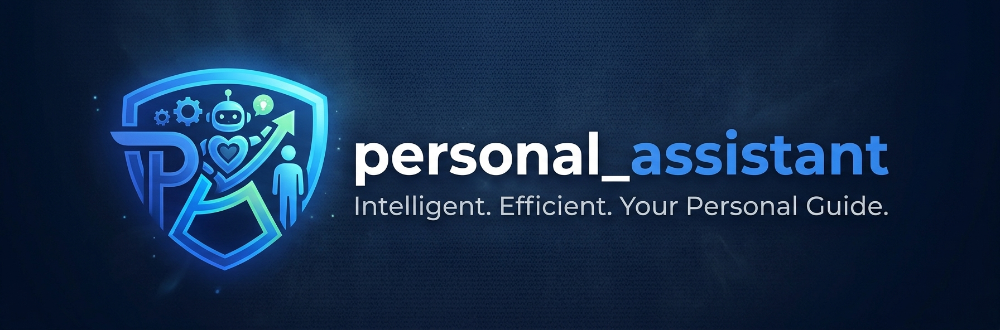
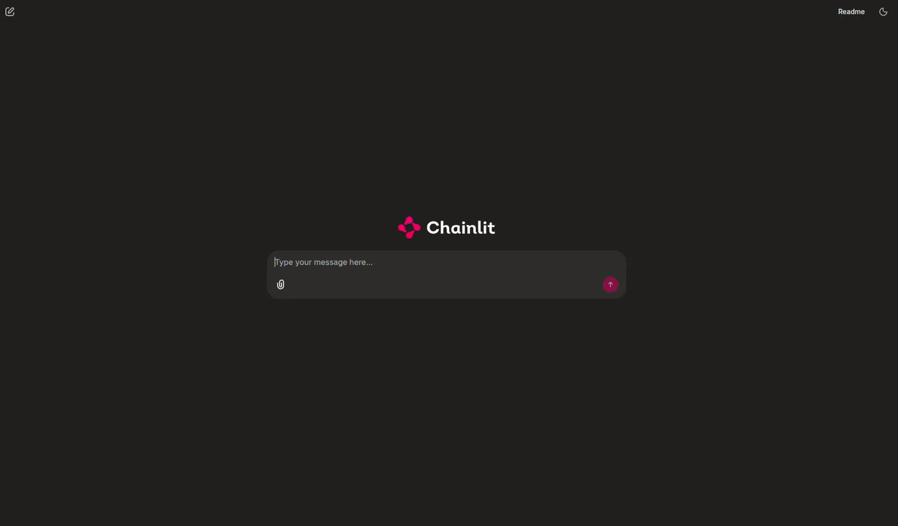

<p align="center">
  
</p>


[](https://codecov.io/github/VijayVignesh1/personal_assistant)
[](https://github.com/VijayVignesh1/personal_assistant/actions/workflows/pre-merge.yml)


A privacy-focused personal AI assistant with long-term memory, semantic retrieval, and local-first data storage, designed to evolve into a private multimodal assistant.

## Table of Contents

- [Demo](#demo)
- [Features](#features)
- [Installation](#installation)
- [Usage](#usage)
- [Contributing](#contributing)
- [License](#license)

## Demo

<p align="center">
  
</p>

## Features

- Persistent Memory: Retains important context across sessions for a personalized experience.

- Local Execution: Runs locally to keep your data private and under your control.

- Conversational Interface: Enables natural interactions through an intuitive chat-based interface.

- Extensible Architecture — Supports integration of additional tools and capabilities.

- Lightweight Setup — Simplifies dependency management and development using uv.

## Installation
The Python code is located in the python/ directory.

### Prequisites
- Python 3.11–3.13
- [uv](https://docs.astral.sh/uv/)
- NVIDIA GPU with CUDA 12.4 support
- NVIDIA driver compatible with CUDA 12.4

### 1. Clonse the repository
```
git clone <repository-url> 
cd personal_assistant
```

### 2. Create the virtual environent
```
uv venv --python 3.11
```

### 3. Activate the virtual environment
#### macOS / Linux
```
source .venv/bin/activate
```

#### Windows:
```
.venv\Scripts\activate
```

### 4. Install dependencies

Install the project and development dependencies:

```
uv sync
```

This installs the dependencies defined in pyproject.toml and creates/updates uv.lock.

NOTE: In order to run the models on GPU CUDA, make sure to install the pytorch version compatible with the underlying CUDA version. To find the cuda version, run `nvidia-smi`. For example, if the cuda version is 12.5, install any pytorch version with cuda 12.5 and below as shown below:
```
uv pip install torch --index-url https://download.pytorch.org/whl/cu124
```


### 5. Verify the installation

#### Run the test suite
```
uv run pytest
```

#### Run linting
```
uv run ruff check . --fix
```

#### Run type checking
```
uv run mypy src
```

### 6. Adding a Package

#### To add a production dependency
```
uv add <package-name>
```
For example:
```
uv add numpy
```

#### To add a development dependency
```
uv add --dev pytest
```

After adding packages, pyproject.toml and uv.lock are updated automatically.


## Usage

1. Launch the chainlit application using:
```
chainlit run main.py -w
```
2. A chat window should open in the default browser automatically. If not, navigate to `http://localhost:8000/`


## Contributing

Contributions are welcome! If you'd like to improve the project, fix bugs, or suggest new features, feel free to contribute.

## Show Your Support

If you find this project useful, please consider giving it a star on GitHub. It helps increase the project's visibility and motivates further development.

If you have suggestions, encounter bugs, or want to contribute, feel free to open an issue or submit a pull request.

Thank you for your support!