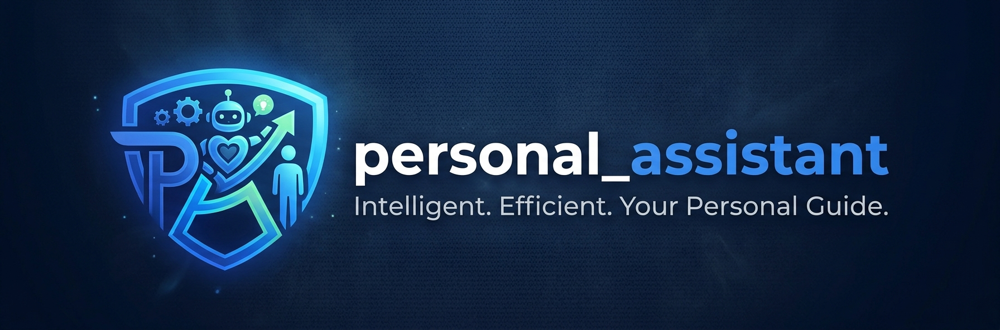
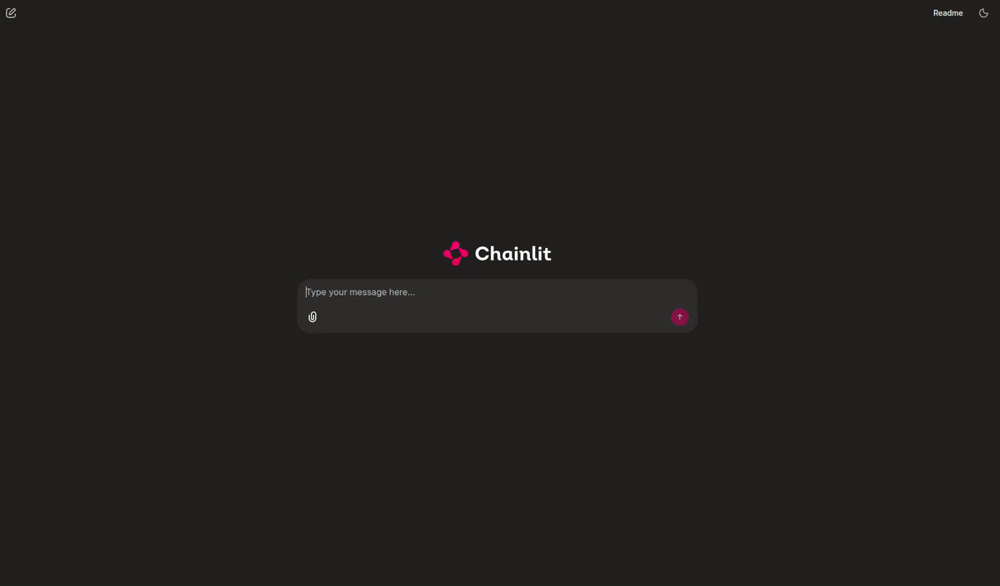

<p align="center">
  
</p>


[](https://codecov.io/github/VijayVignesh1/personal_assistant)
[](https://github.com/VijayVignesh1/personal_assistant/actions/workflows/pre-merge.yml)


A privacy-focused personal AI assistant with long-term memory, semantic retrieval, and local-first data storage, designed to evolve into a private multimodal assistant.

## Table of Contents

- [Demo](#demo)
- [Features](#features)
- [Prequisites](#prequisites)
- [Installation](#installation)
- [Usage](#usage)
- [Contributing](#contributing)
- [License](#license)

## Demo

<p align="center">
  
</p>

## ✨ Features

🧠 Persistent Memory — Remembers what matters across sessions, continuously updating and managing context for a truly personalized experience.

🔒 Local Execution — Runs locally, keeping your data private, secure, and firmly under your control.

🌐 Real-Time Web Connectivity — Searches the web, retrieves relevant information, and delivers up-to-date answers when you need them.

🧩 Extensible Architecture — Easily integrate new tools and capabilities to expand what your assistant can do.

⚡ Quickfire Setup — Get up and running with automated installation, designed to work across a wide range of hardware configurations.

## Prequisites
- Python 3.11–3.13
- [uv](https://docs.astral.sh/uv/)
- Docker

## Installation

```bash
# Clone the repository
git clone <repository-url> 

# Go to project root
cd personal_assistant

# Install the cli
./install.sh

# Install the packages
personal-assistant-install

# Start the assistant
personal-assistant
```

## Contributing

Contributions are welcome! If you'd like to improve the project, fix bugs, or suggest new features, feel free to contribute.

1. **Install in development mode:**
   ```bash
   personal-assistant-install --dev
   ```

2. **Run checks before submitting a PR:**
   ```bash
   uv run --no-sync pytest              # Run test suite
   uv run --no-sync ruff check . --fix  # Lint and auto-fix
   uv run --no-sync mypy src            # Static type checking
   ```

## Show Your Support

If you find this project useful, please consider giving it a star on GitHub. It helps increase the project's visibility and motivates further development.

If you have suggestions, encounter bugs, or want to contribute, feel free to open an issue or submit a pull request.

Thank you for your support!
